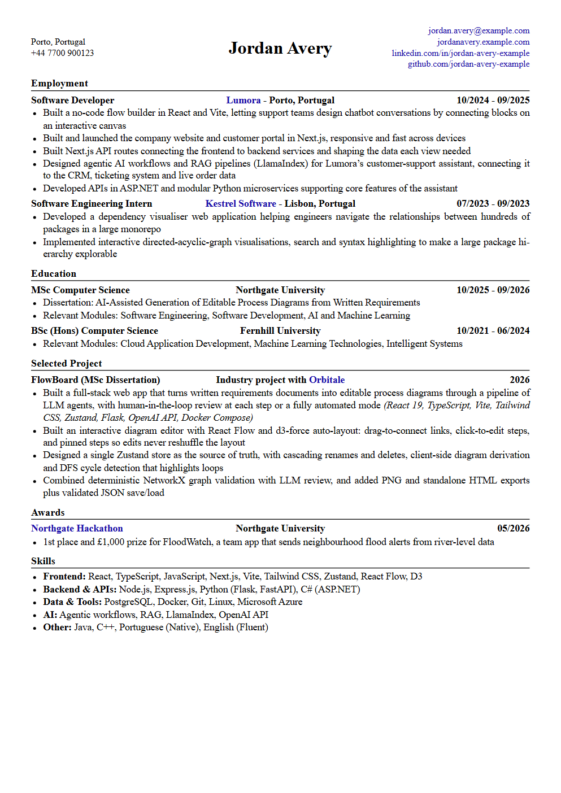

# CV Tailor

Tailor a one-page CV to a job listing with an LLM, **without inventing experience**.
Use Claude, OpenAI, Gemini, OpenRouter, or a local model through Ollama or LM Studio.

You keep one master profile (`data/profile.yaml`) with every fact about your work. For each
job, CV Tailor analyses the listing, picks and rephrases the facts that match, renders a
one-page PDF and gives you an honest gap report. Every bullet on the CV cites the profile
entries it comes from, and code (not just the prompt) rejects any technology, number or
claim those entries don't support.



## What it does

- **Analyse a job**: paste a listing and get must-haves, nice-to-haves, stack, seniority, salary,
  location and right-to-work rules as structured data.
- **Tailor the CV**: choose section order, bullets and skills for the role; every bullet's
  `source` is checked against the profile, and unverified facts are flagged.
- **Gap report**: missing requirements, red flags (salary in another currency, on-site
  elsewhere, years of experience, right to work) and questions to ask you.
- **Grow your profile**: answer a gap-report question in the app and it proposes typed edits to
  `profile.yaml`, shown as a diff, saved with comments intact. Each application makes the next one better.
- **Edit and export**: drag bullets, regenerate one, swap in another fact from the profile, live
  A4 preview, PDF that tightens its own layout to fit one page.
- **Extras**: cover letter (as a PDF with the CV header), about-me blurb, recruiter and referral
  messages, checked sentence by sentence with the same no-invention rule.
- **Tracker**: applications, status, and every CV version you sent (SQLite).
- **Bring your own model**: Claude by default, or any OpenAI-compatible API, chosen per step.
- **Cost logging**: every model call is logged with tokens (and cost, for Claude); see `scripts/usage_report.py`.

Everything runs locally with your own API key. Your profile and tracker never leave your
machine, except for the profile and job text sent to the model you choose. With a local model,
nothing leaves it at all.

## Quick start

Needs Python 3.12+, Node 20+, and either an API key for a model provider or a local model server.

```bash
python -m venv .venv
.venv/Scripts/pip install -r requirements.txt     # macOS/Linux: .venv/bin/pip
.venv/Scripts/python -m playwright install chromium
cp .env.example .env                              # then choose a provider (see below)
cp examples/profile.example.yaml data/profile.yaml
cd frontend
npm install
cd ..
```

Run it:

- **Windows**: double-click `run-cv-tailor.bat` (starts both servers and opens the browser).
- **Anywhere**: `uvicorn backend.main:app --reload` and, in a second terminal,
  `npm run dev` inside `frontend/`, then open http://localhost:5173.

The example profile belongs to Jordan Avery, a fictional developer, so you can try the whole flow
before writing your own.

## Your profile

`data/profile.yaml` is git-ignored. Start from `examples/profile.example.yaml`:

- `person`: name, contact details, optional `header_extras` (e.g. a right-to-work line) you can
  switch on per job.
- `experience`, `projects`, `education`, `awards`: each with an `id`. Bullets and project facts
  have their own ids; that's what the CV cites.
- `verified: false` marks a fact you haven't confirmed; it's allowed but flagged.
- `unconfirmed` / `unconfirmed_details`: things you're unsure about, which are never used as claims.
- `skills`: `strong`, `listed`, `notes`, and `not_claimed` (never shown, always reported as a gap).
- `preferences` (optional): where you live and can work, home currencies, which header line to
  suggest for which region, your sign-off, and free-text `tailoring_notes` (section order, what
  to lead with) that the tailoring prompt follows.

Write facts the way you'd want them on a CV. The model rephrases and merges them but can't add to them.

Optionally, put your best tailored CV in `data/example.tailored.json` (same shape as
`examples/example_frontend.tailored.json`). It replaces the fictional example shown to the model.

## Choosing a model

Set it in `.env` (all options are in `.env.example`):

```bash
# Claude (default)
ANTHROPIC_API_KEY=sk-ant-...

# OpenAI, Gemini, OpenRouter, Groq... (any OpenAI-compatible API)
CV_TAILOR_PROVIDER=openai
CV_TAILOR_BASE_URL=https://openrouter.ai/api/v1
CV_TAILOR_API_KEY=...
CV_TAILOR_MODEL=<a model name from your provider>

# A local model with Ollama (free, nothing leaves your machine)
CV_TAILOR_PROVIDER=openai
CV_TAILOR_BASE_URL=http://localhost:11434/v1
CV_TAILOR_MODEL=<a model you have pulled>
```

`CV_TAILOR_MODEL_<STEP>` picks a model per step (`ANALYSE`, `BULLET`, `ANSWER`, `TAILOR`,
`EXTRAS`): tailoring and cover letters benefit most from a strong model; job analysis is fine
on a small one.

**Smaller models can't make your CV dishonest, just less useful.** The no-invention checks are
code, not prompt: a draft that cites a missing fact or adds a technology or number its sources
don't contain is rejected and retried with feedback, then refused. A weaker model means more
retries and more refusals, not invented experience. Models must support JSON output; for local
models, give them a context window of at least 16K tokens (Ollama: `OLLAMA_CONTEXT_LENGTH=16384`),
because the profile goes into every prompt.

## Settings (`.env`)

| Variable | Default |
|---|---|
| `CV_TAILOR_PROVIDER` | `anthropic`; or `openai` for any OpenAI-compatible API |
| `ANTHROPIC_API_KEY` | needed for Claude |
| `CV_TAILOR_BASE_URL`, `CV_TAILOR_API_KEY` | OpenAI-compatible endpoint and key (none for local servers) |
| `CV_TAILOR_MODEL`, `CV_TAILOR_MODEL_<STEP>` | Claude: Haiku for analyse/bullet/answer, Sonnet for tailor/extras; others: required |
| `CV_TAILOR_DB` | `data/cv_tailor.db` |
| `CV_TAILOR_PROFILE` | `data/profile.yaml` |

## Development

```bash
.venv/Scripts/python -m pytest                       # unit tests (no API calls; use the fictional profile)
.venv/Scripts/python tests/e2e/run.py                # browser end-to-end (some scripts call the API)
python scripts/render_cv.py examples/example_frontend.tailored.json --out out/
python scripts/tailor_job.py job.txt --out out/      # tailor one job from the command line
```

In `frontend/`: `npm test`, `npm run build` (type check), and `npm run gen:types` after changing a
Pydantic model. Live LLM tests cost money and are opt-in: set `CV_TAILOR_LIVE_TESTS=1` in the
environment, then run `pytest tests/test_tailor_live.py`.

Stack: FastAPI, Pydantic v2, Jinja2, Playwright (PDF), SQLite, Anthropic SDK or any
OpenAI-compatible API with structured outputs (`backend/llm/client.py` is the only place that calls a model); React, TypeScript, Vite, Zustand, Tailwind, shadcn/ui. Pydantic models are the single
definition of every JSON contract; the TypeScript types are generated from them. See `SPEC.md`
for the design.

## Licence

MIT. See [LICENSE](LICENSE). Provided as is: issues and pull requests are welcome, but there's
no promise of support.
